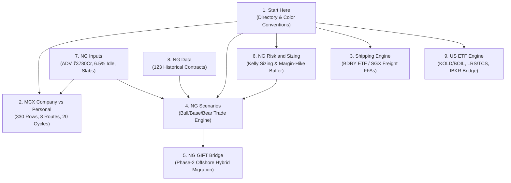

# Quantitative Financial & Treasury Models

This directory contains the core institutional financial models, entity structuring engines, and multi-asset treasury compounding spreadsheets developed for systematic MCX commodity trading and global macro expansion.

---

## Directory Inventory

| File | Size | Primary Focus | Key Instruments |
| :--- | :--- | :--- | :--- |
| [`Final_MCX_Routes_Live.xlsx`](./Final_MCX_Routes_Live.xlsx) | 94 KB | Corporate vs Personal Tax Structuring & Compounding Engine | MCX Natural Gas Futures, Indian Tax Code (s.115BAA vs New Personal Regime), Payroll Loan-Backs |
| [`Global_Macro_Treasury_v9.xlsx`](./Global_Macro_Treasury_v9.xlsx) | 132 KB | Multi-Asset Global Macro, Risk Sizing, Freight, & Cross-Border Treasury | MCX Natural Gas, BDRY Freight FFAs, US Leveraged ETFs (KOLD/BOIL), GIFT City IFSC Bridge |

---

## Model 1: `Final_MCX_Routes_Live.xlsx`

### Executive Summary & Problem Solved
When compounding capital aggressively in Indian commodity futures (75% to 120%+ annualized returns), individual traders face severe tax drag under the personal tax regime (30% slab + 25% surcharge + 4% cess ≈ **39% marginal tax**). 

`Final_MCX_Routes_Live.xlsx` is a 20-cycle dynamic compounding ledger that mathematically models entity selection, liquidity capacity ceilings, idle capital drag, and payroll optimization to determine the optimal corporate structure.

### 1. Key Parameters & Assumptions
- **Starting Capital**: ₹20,00,000 (₹20 Lakhs).
- **Single-Instrument Capacity Ceiling**: ₹103,09,14,000 (~₹103.09 Crores).
  - Derived from 10% participation in MCX Natural Gas Average Daily Volume (ADV).
  - Capital above ₹103.09 Cr cannot be deployed into MCX Natural Gas without market impact and is swept into idle reserves.
- **Idle Capital Yield**: 6.50% p.a. (Liquid Mutual Funds / Overnight Treasury repos).
- **Annual Administrative Overhead**:
  - Personal Route: ₹50,000 / year (CA tax filing, audit).
  - Corporate Route: ₹1,50,000 / year (incorporation, ROC compliance, statutory audit, director fees).

### 2. Tax Regimes & Entity Structuring
1. **Personal Route**:
   - Governed by the Indian New Tax Regime.
   - Slabs graduate rapidly to 30%, with an additional 25% surcharge for ultra-HNW income (>₹5 Cr) plus 4% Health & Education cess.
   - Effective top marginal tax rate: **~39.00%**.
   - No deduction for salaries paid to family members or business administrative overheads beyond basic expenses.

2. **Company Solo (Private Limited under Section 115BAA)**:
   - Concessional corporate tax rate: Flat 22% base + mandatory 10% surcharge + 4% cess = **25.168% effective tax rate**.
   - Preserves an extra ~13.8% of gross trading profits inside the corporate vehicle every cycle.

3. **Company + Payroll Optimization (1 to 3 Employees / Family Members)**:
   - **Section 87A Tax-Free Payroll**: Employs family members/staff at ₹12,75,000/year each. Under the New Tax Regime Section 87A rebate, personal income tax on ₹12.75L is **zero (₹0)**.
   - **Corporate Tax Deduction**: Salaries are deductible as bona fide business expenses, reducing corporate taxable income at 25.168%.
   - **Section 40A(2) Anti-Abuse Defense**: Total payroll is hard-capped at **40% of cycle trading profits** to ensure related-party compensation remains legally justifiable under scrutiny.
   - **Unsecured Loan-Back**: Employees lend back 90% (or 100% in pure model) of post-tax salary to the company as an unsecured subordinated loan, keeping capital fully compounding in the trading pool.

### 3. Multi-Scenario Terminal Wealth Comparison (10-Year Horizon)

Below is the verified performance across the 4 modeled return profiles in the workbook:

| Return Scenario | Personal Route | Company Solo (s.115BAA) | Company + 1 Payroll | Company + 3 Payroll | Corporate Advantage over Personal |
| :--- | :--- | :--- | :--- | :--- | :--- |
| **75% Annual** | ₹32.83 Cr | ₹50.49 Cr | ₹52.88 Cr | **₹57.02 Cr** | **+73.7% (+₹24.19 Cr)** |
| **80% Annual** | ₹40.22 Cr | ₹64.07 Cr | ₹66.97 Cr | **₹72.05 Cr** | **+79.1% (+₹31.83 Cr)** |
| **100% Annual** | ₹84.23 Cr | ₹157.43 Cr | ₹163.53 Cr | **₹174.65 Cr** | **+107.3% (+₹90.42 Cr)** |
| **120% Annual** | ₹169.59 Cr | ₹285.87 Cr | ₹290.72 Cr | **₹299.49 Cr** | **+76.6% (+₹129.90 Cr)** |

#### Key Insights from the Model:
- **Crossover Cycle**: In Year 1–2, the Personal route has a negligible edge due to lower overhead (₹50k vs ₹1.5L). However, by **Cycle 3 (approx. ₹1 Cr AUM)**, the 13.8% tax differential overwhelms overhead, causing corporate wealth to compound exponentially faster.
- **The ₹103 Cr Sweep Effect**: Once deployed capital hits the ₹103.09 Cr ADV liquidity ceiling, additional capital accumulates in the 6.5% idle yield bucket. This creates the exact financial imperative for **Phase 2: Global Macro & GIFT City IFSC expansion** modeled in Workbook 2.

---

## Model 2: `Global_Macro_Treasury_v9.xlsx`

### Architecture & Sheet Guide
`Global_Macro_Treasury_v9.xlsx` is a 9-sheet master quantitative treasury model:

---

### Detailed Sheet Breakdown

#### Sheet 1: `Start Here`
Executive summary, color-coding legend, and cross-sheet navigation:
- **Yellow Cells**: Model inputs & tunable assumptions.
- **Grey / Blue Cells**: Derived accounting formulas & mathematical transformations.
- **Green Cells**: Target KPIs, terminal wealth, and crossover decision flags.

#### Sheet 2: `MCX Company vs Personal`
- **Scope**: 330 rows × 43 columns simulating **8 execution routes**:
  1. Personal Route (Indiv. New Tax Regime)
  2. Company Solo (Section 115BAA)
  3. Company + 1 Employee Payroll
  4. Company + 2 Employees Payroll
  5. Company + 3 Employees Payroll
  6. Company + 4 Employees Payroll
  7. Company + 5 Employees Payroll
  8. Company + 6 Employees Payroll
- **Cycle Horizon**: 20 cycles (18 months per cycle = 30-year runway).
- **Per-Cycle Calculation**:
  $$\text{Deployed Capital} = \min(\text{Opening Capital}, \text{ADV Ceiling } ₹103.09\text{ Cr})$$
  $$\text{Idle Capital} = \max(\text{Opening Capital} - \text{Deployed Capital}, 0)$$
  $$\text{Gross Profit} = (\text{Deployed} \times \text{Cycle Return}) + (\text{Idle} \times 6.5\%)$$
  $$\text{Taxable Income} = \text{Gross Profit} - \text{Overhead} - \min(\text{Salaries}, 40\% \times \text{Gross Profit})$$

#### Sheet 3: `Shipping Engine`
Quantifies the global macro trade on dry bulk freight rates using the Breakwave Dry Bulk Shipping ETF (BDRY) and SGX/ICE Capesize/Panamax Freight Forward Agreements (FFAs).
- **4 Tax Regimes Modeled**:
  - Case A: 0% Tax (Offshore / GIFT City IFSC corporate unit).
  - Case B: 25.168% Corporate Tax (Domestic India Pvt Ltd).
  - Case C: Phased Transition (Personal until ₹20 Cr, then corporate).
  - Case D: 39% Personal High-Slab.
- **Liquidity Regimes**:
  - Cold Market ADV: $82,700 / day.
  - Hot Market ADV: $352,000 / day.
  - Sizing constraint: Maximum position size is strictly capped by 1-day ADV exit liquidity.

#### Sheet 4: `NG Scenarios`
Granular trade-by-trade engine for MCX Natural Gas futures across 3 capital brackets:
- **Capital Tiers**: ₹20 Lakhs (Bootstrapping), ₹75 Lakhs (Growth), ₹2 Crores (Institutional Desk).
- **Market Regimes**:
  - **Bull Regime**: 30% price move, 2 high-conviction trades/yr, Initial Margin = 25.9%.
  - **Base Regime**: 25% price move, 2 trades/yr, Initial Margin = 27.3% (derived from empirical PDF 25–30% volatility bucket).
  - **Bear Regime**: 15% price move, 1 trade/yr, Initial Margin = 28.0%.
- **Frictional Adjustments**:
  - Slippage model: 2.8% daily volatility impact.
  - Corporate tax deducted per trade at 25.168%.
  - Execution strictly respecting the ₹3,780 Crore total daily market ADV.

#### Sheet 5: `NG GIFT Bridge`
Solves the terminal reinvestment problem when domestic MCX capital exceeds capacity (~₹100 Cr):
- **Strategy 1 (MCX Only)**: Stay 100% on MCX India. Beyond ₹103 Cr, all marginal capital earns 6.5% in mutual funds, causing portfolio CAGR to decay toward cash rates.
- **Strategy 2 (Pure GIFT Switch)**: Liquidate domestic vehicle at ₹20 Cr and move 100% offshore to GIFT City IFSC.
- **Strategy 3 (Hybrid Engine - Optimal)**:
  - Keep domestic MCX Private Limited running at maximum deployable capacity (₹100 Cr).
  - Continuously sweep 100% of excess cash flow into a wholly-owned subsidiary in **GIFT City IFSC**.
  - Trade CME/NYMEX Henry Hub futures & options under Section 80LA (10-year 100% corporate tax holiday) in USD with institutional global liquidity.
  - **Result**: Terminal wealth compounds without capacity ceiling drag.

#### Sheet 6: `NG Risk and Sizing`
Contains the core risk mechanics governing position sizing and survival:

1. **Roll & Cost Drag**:
   - Quantifies the contango penalty of rolling expiring MCX Natural Gas futures contracts into the next active month (historical roll gaps: 0.5% to 2.0% per month).
   - Incorporates statutory exchange turnover fees, SEBI charges, stamp duty, and clearing fees.

2. **The Margin-Hike Trap & Free Cash Buffer**:
   - Analysis of **16.4 years of MCX historical data** reveals **23 quiet-spike events** where exchange clearinghouses unexpectedly hiked initial margins by 10% to 20% overnight during extreme volatility.
   - Derives the mandatory free unencumbered cash buffer formula:
     $$\text{Free Cash Buffer} \ge 1 - \frac{\text{Margin}_{\text{initial}}}{\text{Margin}_{\text{stressed}}}$$
   - *Example*: If normal margin is 25% and stress margin hikes to 40%, an operator must hold at least:
     $$1 - \frac{25\%}{40\%} = 37.5\%$$
     in unencumbered cash or liquid collateral to prevent forced liquidation during exchange margin calls.

3. **Kelly Criterion vs Half-Kelly**:
   - Full Kelly optimal leverage fraction:
     $$f^* = \frac{p}{a} - \frac{1 - p}{b}$$
     *(where $p$ = win rate, $b$ = upside return, $a$ = downside loss)*
   - Mathematical proof: Full Kelly maximizes theoretical long-term geometric growth but carries an unacceptable ~33% probability of halving capital in fat-tailed commodity distributions.
   - The model establishes **Half-Kelly ($0.5 \times f^*$)** as the desk policy: achieves 75% of the theoretical growth rate while slashing drawdown variance by 50%.

#### Sheet 7: `NG Inputs`
Central parameter matrix feeding the workbook:
- Corporate tax rate: 25.168% (s.115BAA).
- Personal tax slab table (New Tax Regime 2024–2026).
- MCX ADV ceiling: ₹3,780 Crores.
- Liquid fund yield: 6.50%.

#### Sheet 8: `NG Data`
Empirical dataset spanning **123 contract legs from 2020 through 2026**:
- Tracks initial margin percentage, lot sizes, contract values, and absolute rupee margin requirements across commodity price cycles ($1.50/MMBtu to $10.00/MMBtu).
- Proves non-linear margin scaling during acute commodity shocks.

#### Sheet 9: `US ETF Engine`
Engine for trading US leveraged commodity instruments (KOLD - UltraShort Natural Gas -2x, BOIL - Ultra Natural Gas 2x, TQQQ, SOXL):
- **Regulatory Framework**:
  - Governed by RBI's **Liberalised Remittance Scheme (LRS)** limit: $250,000 (~₹2.1 Crores) per individual per financial year.
  - Models the 20% Tax Collected at Source (TCS) on remittances above ₹7 Lakhs, structured as an advance tax credit offset.
- **Brokerage Architecture Transition**:
  - Under ₹2 Cr: Retail route via INDmoney (0.25% brokerage + 0.60%–0.80% FX conversion spread).
  - Over ₹2 Cr: Institutional route via Interactive Brokers (IBKR Pro LLC) (0.05% brokerage + 0.40% FX spread via direct wire), cutting friction by >65%.

---

## Strategic Connection to the MCX Margins Application

The models in this directory provide the quantitative foundation for the features deployed in this repository:
1. **Live Margin Scraper (`src/scraper.py`)**: Feeds the real-time initial margin requirements and contract values into the `NG Scenarios` and `NG Risk and Sizing` engines.
2. **Dynamic Inception Harvester (`scripts/harvest_all_mcx_commodities.py`)**: Captures historical 1-minute microstructure used to calibrate volatility buckets and margin-hike probabilities.
3. **Desk Treasury Sizing**: Translates daily margin fluctuations into exact position sizes that honor the Half-Kelly allocation and the 37.5% margin-hike cash buffer.
