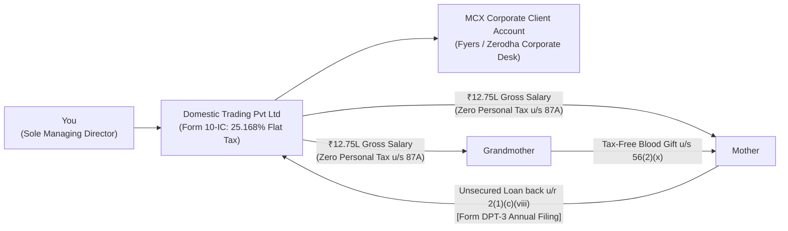
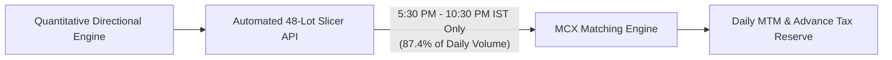
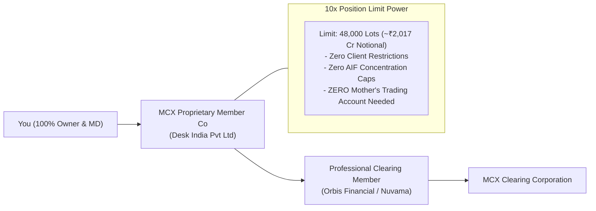
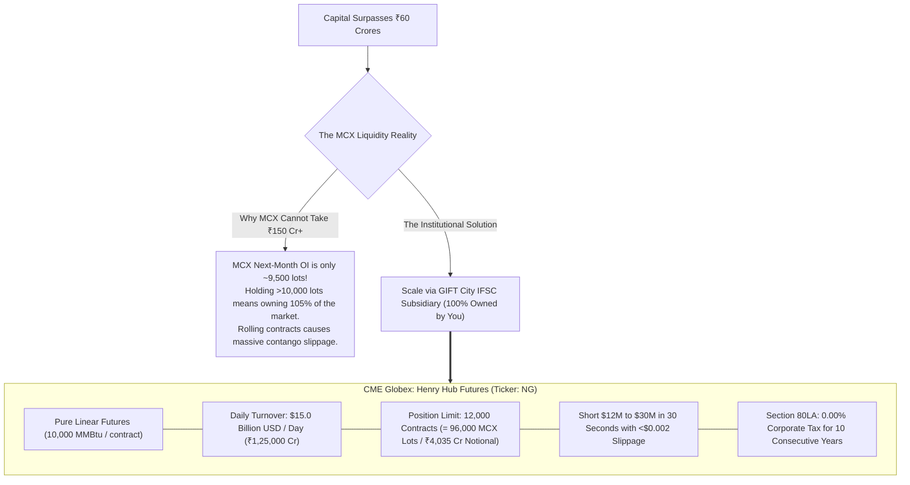

# Master Institutional Blueprint: The 5-Level Pure Futures Progression (₹60 Lakhs to ₹700+ Crores)

---

## Executive Summary & Core Progression Architecture

This document provides a level-by-level institutional roadmap for scaling an MCX commodity futures desk from **₹60 Lakhs to ₹700+ Crores**. It eliminates all unnecessary complexities (no options, no dummy friends, no redundant family trading accounts) and replaces them with a **single, unified corporate progression** governed by statutory approvals and net-worth gating.

```mermaid
flowchart TD
    L0["LEVEL 0: Genesis Foundation (₹60 Lakhs)\n- Single Pvt Ltd under Section 115BAA (25.17% Tax)\n- Mother & Grandmother Payroll Optimization (Saves ₹6.42L/yr tax; ₹0 personal tax)\n- Standard MCX Client Account (Limit: 4,800 Lots)"]
    
    L1["LEVEL 1: Automated Execution (₹5 Cr to ₹15 Cr)\n- Algorithmically Sliced 48-Lot Execution (5:30 PM - 10:30 PM IST)\n- Section 44AB Tax Audit & Advance Tax Compliance\n- Build Balance Sheet Net Worth for Institutional Upgrades"]
    
    L2["LEVEL 2: Institutional Gating Milestone (₹15 Cr to ₹25 Cr Net Worth)\n⚡ INITIATE BOTH APPROVAL TRACKS IN PARALLEL (Takes 60-90 Days):\n1. MCX Proprietary Trading Member (TM) Application (>₹1 Cr Net Worth)\n2. GIFT City IFSC Subsidiary Setup (RBI ODI Rules: up to 400% Net Worth)"]
    
    L3["LEVEL 3: Domestic Market Dominance (₹25 Cr to ₹60 Cr)\n- MCX Proprietary Trading Member Active\n- Position Limit Jumps 10x to 48,000 LOTS (~₹2,017 Cr Notional)\n- Professional Clearing Member (PCM: Orbis / Nuvama)\n- ZERO Mother's Trading Account Needed | 100% Owned by You"]
    
    L4["LEVEL 4: Sovereign Global Super-Scale (₹60 Cr to ₹700+ Cr)\n- GIFT City IFSC Subsidiary Active (100% Owned by You)\n- Trade CME Henry Hub Futures (NG) in USD via Institutional FCM\n- Limit: 12,000 CME Contracts (= 96,000 MCX Lots / ~₹4,035 Cr Notional)\n- Section 80LA: 0.00% Corporate Tax for 10 Consecutive Years"]

    L0 ==> L1 ==> L2 ==> L3 ==> L4
```

---

## The 5 Institutional Progression Levels

---

### LEVEL 0: Genesis Foundation (Capital: ₹60.00 Lakhs)

#### 1. Entity Setup & Approvals
* **Corporate Entity**: Private Limited Company incorporated under the Companies Act, 2013 via MCA portal (SPICe+ Form).
  * MoA Objects Clause: Explicitly authorizes proprietary trading in commodity and financial derivatives.
  * Directors: You (Managing Director).
  * Setup Timeline: **7 to 10 days**. Cost: ~₹15,000.
* **Bank & Broker Accounts**:
  * Corporate Current Account: HDFC / ICICI / Kotak Bank (3–5 days).
  * Corporate Broker Trading & Demat Account: Fyers or Zerodha Corporate Desk. Requires Board Resolution, initial CA Net Worth Certificate, and CKYC of directors (5–7 days).

#### 2. Tax Strategy & Flowback Engine
* **Section 115BAA Election**: Form 10-IC filed electronically before the ITR due date $\rightarrow$ **Flat 25.168% corporate tax rate** (22% base + 10% surcharge + 4% cess).
* **Mother & Grandmother Payroll (The ₹6.42 Lakhs Annual Tax Shield)**:
  * Annual salary of **₹12,75,000** paid to Mother (Administrative Coordinator) and Grandmother (Family Welfare Advisor).
  * Gross ₹12.75L - ₹75k std deduction = ₹12.00L taxable income. Section 87A rebate wipes personal income tax to **₹0.00 (Nil Tax)**.
  * Corporate Tax Deduction: The company deducts ₹25.50L as business expenditure, saving:
    $$₹25,50,000 \times 25.168\% = \mathbf{₹6,41,784\text{ in cash tax saved every year}}.$$
* **The Legal Flowback to Company (Zero Directorships Required)**:
  * **Mother**: Loans ₹12.75L back directly under **Rule 2(1)(c)(viii)** of Companies (Acceptance of Deposits) Rules as a relative of a director.
  * **Grandmother**: Gifts ₹12.75L to Mother or Director under **Section 56(2)(x)** (100% tax-free between lineal ascendants/descendants), who then loans it back under Rule 2(1)(c)(viii).
  * Declared annually in **Form DPT-3** filed with the ROC by June 30th.

#### 3. Trading & Execution
* **Status**: Standard **Client** on MCX.
* **Instrument**: MCX Natural Gas November Futures (`NATURALGAS` - 1,250 MMBtu).
* **Position Size**: 50 to 60 lots (~₹2.1 Cr Notional).
* **Margin Deployed**: ~₹36 Lakhs (14.25% margin). Cash Buffer: ~₹24 Lakhs (40% buffer in overnight liquid yield).

---

### LEVEL 1: Automated Execution & Scale (Capital: ₹5 Crores to ₹15 Crores)

#### 1. Financial & Operational Milestones
* **Position Size**: 400 to 1,200 lots of Natural Gas Futures (~₹17 Cr to ₹50 Cr Notional).
* **Regulatory Status**: Still a standard **Client** on MCX (well below the 4,800-lot cap).
* **Compliance Requirements**:
  * Mandatory Tax Audit under **Section 44AB** of the Income Tax Act (turnover > ₹10 Crores).
  * Quarterly Advance Tax compliance (June 15, Sept 15, Dec 15, March 15).
* **Execution Infrastructure**:
  * Order Slicing API: Connect Python trading engine to broker API (Fyers / Zerodha).
  * All entries paced in **48-lot clips** strictly between **5:30 PM and 10:30 PM IST** (capturing US market liquidity overlap).

---

### LEVEL 2: The Gateway Milestone (Net Worth: ₹15 Crores to ₹25 Crores)

```mermaid
flowchart TD
    Milestone["Net Worth Hits ₹15 Cr - ₹25 Cr\n⚡ CRITICAL APPROVAL INITIATION WINDOW"]
    
    subgraph TrackA["Track 1: MCX Proprietary Trading Member (TM)"]
        A1["Net Worth Gating: >₹1.00 Crore (You have 15x-25x hurdle)"]
        A2["Admission Fee: ₹2.5L - ₹5L | BMC Deposit: ₹10L - ₹25L"]
        A3["Compliance Officer with NISM Series XVI Certification"]
        A4["Professional Clearing Member (PCM) Agreement with Orbis / Nuvama"]
        A5["SEBI Form A Stock Broker Registration (Takes 60-90 Days)"]
        A1 --> A2 --> A3 --> A4 --> A5
    end

    subgraph TrackB["Track 2: GIFT City IFSC Subsidiary Setup"]
        B1["RBI ODI Rules 2022: Can remit up to 400% of Net Worth (₹60 Cr - ₹100 Cr)"]
        B2["Incorporate Wholly-Owned Subsidiary in GIFT City SEZ"]
        B3["IFSCA Regulatory Clearance & USD Bank Account (ICICI / Kotak IBU)"]
        B4["Onboard with US FCM (Interactive Brokers LLC / StoneX)"]
        B5["Fund $100k - $250k Testbed Account on CME Henry Hub (Takes 60-90 Days)"]
        B1 --> B2 --> B3 --> B4 --> B5
    end

    Milestone ==> TrackA
    Milestone ==> TrackB
```

#### Why You Start Approvals NOW (Not at ₹60 Crores):
* Regulatory approvals take **3 to 4 months**. If you wait until ₹60 Cr, your trading compounds into a dead end while waiting for paperwork.
* **At ₹15 Cr to ₹25 Cr Net Worth, you already satisfy 100% of the statutory eligibility criteria**:
  1. MCX TM Net Worth Hurdle: **₹1.00 Crore** (You have ₹15 Cr–₹25 Cr $\rightarrow$ **15x to 25x the requirement**).
  2. RBI ODI Remittance Ceiling: **400% of Net Worth** (At ₹20 Cr net worth, you are legally authorized to remit up to **₹80 Crores / ~$9.6M USD** abroad).

---

### LEVEL 3: Domestic Market Dominance (Capital: ₹25 Crores to ₹60 Crores)

#### 1. Operational Realities
* **Entity**: `Desk India Pvt Ltd` operating as an **MCX Proprietary Trading Member (TM)**.
* **Position Size**: 2,000 to 4,800 lots (~₹84 Cr to ₹201.78 Cr Notional).
* **The Massive Strategic Advantage**:
  * Ordinary clients hit the SEBI hard ceiling at 4,800 lots.
  * Your company now has a **48,000-lot limit**!
  * **Mother's independent trading account is completely unnecessary.** You run 100% of the capital inside your own vehicle with zero nominee risk.
* **Execution Protocol (November Contract: 23,258 Lots/Day ADV)**:
  * 4,800 lots = 20.6% of daily volume.
  * **Desk Standard: 3-Evening Sliced Execution**:
    * 1,600 lots / evening (6.9% of daily volume).
    * 33 clips of 48 lots paced every 11 minutes between **5:30 PM and 10:30 PM IST**.
    * Slippage is minimal (<0.20%).

---

### LEVEL 4: Sovereign Global Super-Scale (Capital: ₹60 Crores to ₹700+ Crores)

#### Why Global Scale is Essential Past ₹60–₹100 Crores:
* In your spreadsheet (`Final MCX Routes Live.xlsx`), capital reaches **₹706 Crores at Year 20**, but cell B11 caps deployable capital at ₹103 Cr, leaving **₹603 Crores idle in cash at 6.5%**.
* In Level 4, you eliminate idle cash drag by routing all surplus capital into **CME Henry Hub Futures**:
  1. **100% Controlled by You**: The GIFT City unit is a Wholly-Owned Subsidiary of your Indian company. Zero friends, zero nominees.
  2. **Tax Rate**: **0.00% Corporate Tax for 10 years** under Section 80LA of the Income Tax Act. Zero STT, Zero CTT, Zero Stamp Duty.
  3. **Capacity**: 12,000 CME contracts absorbs **up to ₹4,035 Crores of notional futures** without moving the bid-ask spread.

---

## 3. Comprehensive Master Matrix: All 5 Levels Compared

| Level | Capital Range | Regulatory Entity Status | Key Approvals & Gating Conditions | Approval Lead Time | Tax Rate & Shields | MCX / CME Position Limit | Execution Horizon |
| :--- | :--- | :--- | :--- | :--- | :--- | :--- | :--- |
| **Level 0** | ₹60 Lakhs to ₹5 Cr | Private Limited (Client) | MCA SPICe+, Corporate Bank Account, Fyers/Zerodha Corporate Demat | 10 to 14 Days | **25.17% (s.115BAA)** Mother/Gran Payroll saves ₹6.42L/yr | 4,800 Lots (Client Limit) | Single Session (50–100 lots) |
| **Level 1** | ₹5 Cr to ₹15 Cr | Private Limited (Client) | Section 44AB Tax Audit, Quarterly Advance Tax, Broker Algo API Declaration | Ongoing | **25.17% (s.115BAA)** Advance Tax Form 280 | 4,800 Lots (Client Limit) | 1 to 2 Evenings (48-lot clips) |
| **Level 2** | **₹15 Cr to ₹25 Cr** *(Net Worth)* | **Dual-Track Gating** | 1. Net worth certificate >₹1 Cr 2. Submit MCX TM application 3. Submit GIFT City IFSCA application | **60 to 90 Days** *(Initiate Now!)* | **25.17% (s.115BAA)** Prepares 0% Tax GIFT Vehicle | Prepares 10x limit jump | Testbed on CME ($100k–$250k) |
| **Level 3** | ₹25 Cr to ₹60 Cr | **MCX Proprietary TM** | SEBI Broker Registration, MCX Base Minimum Capital deposit, PCM Agreement (Orbis) | Active | **25.17% (s.115BAA)** Zero AIF restrictions | **48,000 Lots (TM Limit)** (~₹2,017 Cr Notional) | **3 Evenings** (1,600 lots/day, <0.20% slippage) |
| **Level 4** | ₹60 Cr to ₹700+ Cr | **GIFT City IFSC Unit** | IFSCA License, USD IBU Bank Account, US FCM Institutional Account (IBKR/StoneX) | Active | **0.00% Corporate Tax** (Section 80LA for 10 Years) | **12,000 CME Contracts** (~₹4,035 Cr Notional) | **30 Seconds** (<$0.002 slippage on CME) |
