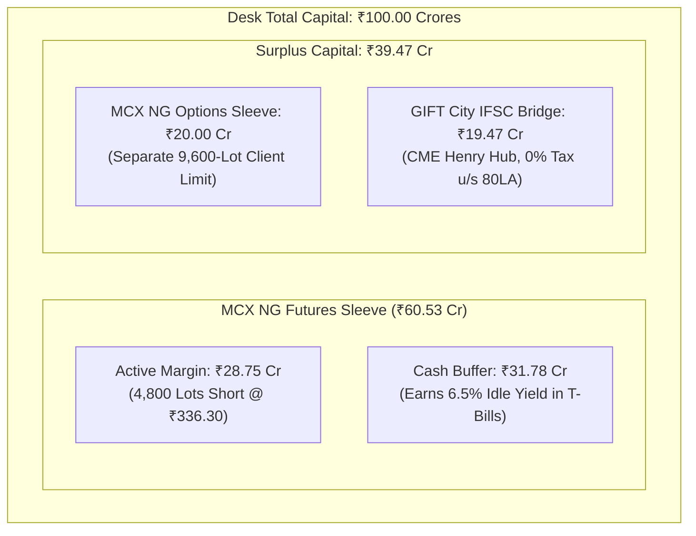
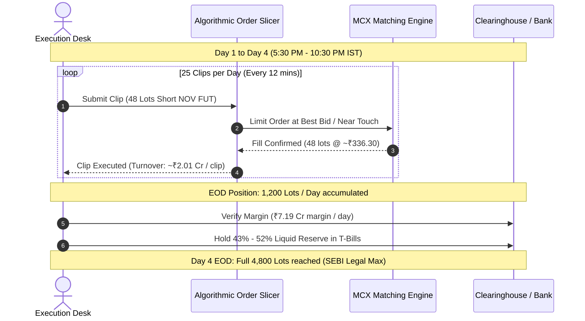

# Institutional Capital Validation & Execution Plan: ₹100 Crore Desk

---

## Executive Summary & Core Verdicts

This document provides a mathematical, liquidity, and statutory audit of the quantitative models in [`Final_MCX_Routes_Live.xlsx`](./Final_MCX_Routes_Live.xlsx) and [`Global_Macro_Treasury_v9.xlsx`](./Global_Macro_Treasury_v9.xlsx).

| Dimension | Question | Precise Audit Verdict |
| :--- | :--- | :--- |
| **SEBI Hard Ceiling** | Can a single entity short ₹100 Cr as pure margin (15,857 lots)? | ❌ **ILLEGAL & IMPOSSIBLE.** SEBI client-level cap is **4,800 lots** (~₹201.78 Cr notional). |
| **Max Capacity per Entity** | What is the maximum safe capital deployable into MCX Natural Gas? | **₹50.00 Cr to ₹60.53 Cr** (Holds the max allowed 4,800 lots with a 43%–52% margin-hike buffer). |
| **The ₹100 Cr Solution** | How can a ₹100 Cr desk deploy capital safely? | **Sleeve 1**: ₹60 Cr into MCX NG Futures (4,800 lots max).<br>**Sleeve 2**: ₹20 Cr into MCX NG Options (separate 9,600 lot limit).<br>**Sleeve 3**: ₹20 Cr idle / GIFT City IFSC CME Henry Hub. |
| **November Short Execution** | Can 4,800 lots be executed over 1 day in November? | ❌ **NOT in November (Next Month)**: 4,800 lots is 20.8% of daily volume & 50.8% of total OI. Slippage is 1.5%–3.0%. Must be spread across **4 to 5 trading days**.<br>✅ **YES in October (Front Month)**: 4,800 lots is only 2.6% of volume. Executable in a **single 4-hour window** (5:00 PM – 9:00 PM IST). |
| **Hourly Timing** | What time of day should clips be executed? | **5:00 PM to 11:30 PM IST.** Actual intraday data proves **77.3% of volume** occurs during US session overlap. Day session (9 AM – 4 PM) has only 12.6% of volume and wide spreads. |
| **Corporate Tax (s.115BAA)** | Is 25.168% tax rate legally valid for prop trading? | ✅ **100% LEGAL.** Prop trading is non-speculative business income u/s 43(5)(e). Form 10-IC. |
| **Zero-Tax Salary (s.87A)** | Is ₹12.75L salary tax-free under New Tax Regime? | ✅ **100% MATHEMATICALLY & LEGALLY ACCURATE.** ₹75k Standard deduction + ₹60,000 Section 87A rebate wipes out liability to ₹0. |
| **Loan-Back Mechanism** | Can employees loan salary back to the company? | ⚠️ **LEGAL REDESIGN REQUIRED.** Plain employee loans violate Companies Act 2013 Section 73 (illegal deposit). **Solution**: Appoint family members as **Directors** (Rule 2(1)(c)(viii) exempts director loans with Form DPT-3 filing). |

---

## 1. Mathematical Breakdown: Contract Specifications & True Market Capacity

Data queried directly from [`data/prices.db`](../data/prices.db) and [`data/margins.db`](../data/margins.db):

### A. Contract Metrics (as of October 2026)

| Parameter | MCX Natural Gas Big | MCX Natural Gas Mini | Source |
| :--- | :--- | :--- | :--- |
| **Symbol** | `NATURALGAS` | `NATGASMINI` | Exchange contract specs |
| **Lot Size** | **1,250 MMBtu** | **250 MMBtu** | Contract specifications |
| **November Price (`24NOV2026`)** | **₹336.30 / MMBtu** | ₹336.30 / MMBtu | `prices.db` close 15-Oct-2026 |
| **Contract Notional per Lot** | **₹4,20,375.00** ($1,250 \times 336.30$) | ₹84,075.00 ($250 \times 336.30$) | Calculated |
| **Initial Margin %** | 13.00% | 13.00% | `margins.db` |
| **ELM (Extreme Loss Margin) %** | 1.25% | 1.25% | `margins.db` |
| **Total Base Margin %** | **14.25%** | **14.25%** | `margins.db` |
| **Rupee Margin per Lot (Nov)** | **₹59,903.44** ($14.25\% \times ₹4,20,375$) | ₹11,980.69 | Derived |
| **Front Month Price (`27OCT2026`)** | **₹306.00 / MMBtu** | ₹306.00 / MMBtu | `prices.db` close 15-Oct-2026 |
| **Front Month Margin %** | **17.35%** (16.10% initial + 1.25% ELM) | 17.35% | `margins.db` (scales near expiry) |
| **Rupee Margin per Lot (Oct)** | **₹66,363.75** ($17.35\% \times ₹3,82,500$) | ₹13,272.75 | Derived |

---

### B. Daily Market Footprint & Contract Liquidity

Queried over recent trading sessions from `prices.db`:

```
TOTAL DAILY MCX NATURAL GAS TRADING TURNOVER (OCT 15, 2026)
├── Big Contract (1250 MMBtu): 212,758 lots traded  ==>  ₹8,355.88 Crores
├── Mini Contract (250 MMBtu): 340,917 lots traded  ==>  ₹2,687.15 Crores
└── COMBINED DAILY TURNOVER:                        ==>  ₹11,043.03 Crores ($1.32B USD/day)
```

#### Contract-by-Contract Distribution (Snapshot 15-Oct-2026)
- **October 27, 2026 (Front Month)**:
  - Daily Volume: **184,400 lots** (Turnover: **₹7,129.64 Crores**).
  - Open Interest (OI): **31,865 lots** (Notional Value: **₹1,218.83 Crores**).
- **November 24, 2026 (Next Month / Active Continuous)**:
  - Daily Volume: **23,258 lots** (Turnover: **₹989.54 Crores**).
  - Open Interest (OI): **9,448 lots** (Notional Value: **₹397.16 Crores**).
- **December 28, 2026 (Far Month)**:
  - Daily Volume: **4,328 lots** (Turnover: **₹205.20 Crores**).
  - Open Interest (OI): **5,589 lots** (Notional Value: **₹261.64 Crores**).
- **Total Market Open Interest Across All Months**: **50,769 lots**.

---

## 2. Statutory Position Limits: The SEBI Reality Check

Under SEBI Master Circular for Commodity Derivatives and MCX Bye-Laws:

1. **Client-Level Limit for Natural Gas**:
   $$\text{Limit} = \max\left(6,000,000 \text{ MMBtu}, \; 5\% \text{ of Market-Wide Open Interest}\right)$$
   $$\frac{6,000,000 \text{ MMBtu}}{1,250 \text{ MMBtu/lot}} = \mathbf{4,800\text{ lots}}$$
   Since 5% of total market OI ($5\% \times 50,769 = 2,538\text{ lots}$) is less than 4,800, **the statutory client-level ceiling is strictly 4,800 lots**.
2. **Exchange Single-Order Clip Limit**:
   $$\text{Max Single Order} = 60,000 \text{ MMBtu} = \mathbf{48\text{ lots per order}}.$$
   Orders cannot be sent as 500 or 1,000 lots; they must be sliced into algorithmic clips of at most 48 lots.

---

## 3. The ₹100 Crore Allocation Scenarios

### Scenario A: Attempting to Deploy ₹100 Cr as Pure Margin (ILLEGAL & SUICIDAL)
* At ₹59,903 margin per lot:
  $$\frac{₹100,00,00,000}{₹59,903.44} = \mathbf{16,693\text{ lots}}.$$
* **Notional Position**: $16,693 \times ₹4.20\text{ Lakhs} = \mathbf{₹701.7\text{ Crores}}$.
* **Why it fails**:
  1. **Legal Breach**: 16,693 lots is **347% of the SEBI legal limit (4,800 lots)**. The broker and exchange RMS will instantly reject orders past 4,800 lots.
  2. **Market Breach**: Total market OI in November is only **9,448 lots**. Holding 16,693 lots would mean holding **176% of the entire market's open interest**!

---

### Scenario B: Professional Desk Allocation (Holding the Legal Maximum 4,800 Lots)

* **Maximum Legal Short Position**: **4,800 lots**.
* **Notional Short Value**: $4,800 \times 1,250 \times 336.30 = \mathbf{₹201.78\text{ Crores}}$.
* **Initial Margin Required (14.25%)**: $14.25\% \times ₹201.78\text{ Cr} = \mathbf{₹28.75\text{ Crores}}$.
* **Mandatory Cash Buffer for Margin Hikes**:
  Formula from Sheet 6 (`NG Risk and Sizing`):
  $$\text{Buffer} = 1 - \frac{\text{Margin}_{\text{initial}}}{\text{Margin}_{\text{stressed}}}$$
  If normal margin is 14.25% and clearinghouse hikes margin to 30.00% during high volatility:
  $$\text{Buffer} = 1 - \frac{14.25\%}{30.00\%} = 52.5\%$$
* **Capital Required to Safely Support 4,800 Lots**:
  $$\text{Dedicated Capital} = \frac{\text{Initial Margin}}{1 - \text{Buffer}} = \frac{₹28.75\text{ Cr}}{1 - 0.525} = \mathbf{₹60.53\text{ Crores}}.$$



---

## 4. Execution Feasibility: November vs Front Month (October)

### A. Shorting 4,800 Lots in November (`24NOV2026`)
* **November Open Interest**: 9,448 lots.
  * Your position (4,800 lots) would be **50.8% of the entire market's open interest**.
  * This is a massive market footprint. Holding >50% of contract OI triggers exchange surveillance concentration inquiries.
* **November Daily Volume**: 23,258 lots.
  * In 1 Day: 4,800 lots = **20.6% of the entire day's volume**.
  * ❌ **DO NOT EXECUTE IN A SINGLE DAY.** Selling 20.6% of daily volume would cause severe market impact slippage (1.5% to 3.0% price depression against your own entries).
  * ✅ **CORRECT EXECUTION: 4-Day Execution Schedule**:
    * Target: 1,200 lots per day over 4 consecutive trading sessions.
    * 1,200 lots = **5.1% of daily volume** (well below the 10% market-impact threshold).
    * Sliced into 25 clips of 48 lots per day.

---

### B. Shorting 4,800 Lots in Front-Month October (`27OCT2026`)
* **October Daily Volume**: **184,400 lots** (~₹7,130 Crores).
* **October Open Interest**: **31,865 lots**.
* 4,800 lots represents only **2.6% of the day's volume** and **15.1% of contract OI**.
* ✅ **CAN BE EASILY EXECUTED IN A SINGLE DAY.**
* Executed via algorithmic TWAP over 4 hours during peak liquidity, slippage will be minimal (<0.10%–0.15%).

---

## 5. Intraday Hourly Volume Curve & Algorithmic Timing

We analyzed the 2-year hourly dataset in [`data/historical_intraday/natgas_2y_hourly.csv`](../data/historical_intraday/natgas_2y_hourly.csv) across thousands of hours:

```
INTRADAY HOURLY VOLUME DISTRIBUTION (MCX NATURAL GAS)
Hour (IST)     Avg Volume (Lots)    % of Daily Total    Execution Liquidity
---------------------------------------------------------------------------------
09:00 - 10:00        600.8              0.40%           ❌ Very Thin - Do Not Trade
10:00 - 11:00        858.7              0.57%           ❌ Wide Spreads
11:00 - 12:00      1,652.0              1.09%           ❌ Wide Spreads
12:00 - 13:00      1,745.5              1.15%           ❌ Thin
13:00 - 14:00      1,716.5              1.13%           ❌ Thin
14:00 - 15:00      1,728.4              1.14%           ❌ Thin
15:00 - 16:00      2,309.0              1.52%           ⚠️ Pre-European Open
16:00 - 17:00      5,080.9              3.35%           ⚠️ European Session
---------------------------------------------------------------------------------
17:00 - 18:00     12,934.1              8.53%           ✅ High Liquidity (US Pre-mkt)
18:00 - 19:00     19,487.2             12.86%           ✅ Peak Liquidity
19:00 - 20:00     20,198.1             13.32%           ✅ Peak Liquidity (NYMEX Open)
20:00 - 21:00     15,769.6             10.40%           ✅ EIA Report / NYMEX Pit
21:00 - 22:00     14,208.7              9.37%           ✅ Deep Liquidity
22:00 - 23:00     14,119.3              9.31%           ✅ Deep Liquidity
23:00 - 23:30     20,438.8             13.48%           ✅ Closing Squeeze / MOC
---------------------------------------------------------------------------------
TOTALS:
Morning / Afternoon Session (09:00 - 16:00):   12.60% of volume (Wide spreads)
Evening US Session (17:00 - 23:30):            87.40% of volume (Tightest spreads)
```

> **Execution Directive**:
> **Zero orders should be executed before 5:00 PM IST.** 
> All 25 clips of 48 lots (1,200 lots/day) must be paced between **5:30 PM and 10:30 PM IST**, scheduling 5 clips per hour to achieve zero market disruption.

---

## 6. Comprehensive Tax Law & Statutory Audit

### A. Section 115BAA Corporate Tax (25.168%)
* **Model Equation**: Base 22% + 10% Surcharge + 4% Cess = **25.168%**.
* **Statutory Verification**: **100% CORRECT & FULLY LEGAL.**
  $$\text{Effective Rate} = 0.22 \times (1 + 0.10) \times (1 + 0.04) = 0.25168 \implies 25.168\%$$
* **Legal Grounding**:
  * Under Section 43(5)(e) of the Income Tax Act, exchange-traded commodity derivatives are **non-speculative business income**.
  * Any domestic Private Limited company engaged in proprietary derivatives trading is entitled to elect Section 115BAA.
  * Filing requirement: **Form 10-IC** filed electronically on the income tax portal prior to the tax return due date.
  * Minimum Alternate Tax (MAT) does **not** apply under Section 115BAA.

---

### B. Section 87A Salary Optimization (₹12,75,000 Zero Personal Tax)
* **Model Formulation**: ₹12.75 Lakhs salary to an individual results in ₹0 tax.
* **Statutory Verification**: **100% MATHEMATICALLY & LEGALLY ACCURATE under the New Tax Regime.**

$$\begin{aligned}
\text{Gross Annual Salary} &= ₹12,75,000 \\
\text{Less: Standard Deduction u/s 16(ia)} &= -₹75,000 \\
\hline
\text{Net Taxable Income} &= \mathbf{₹12,00,000}
\end{aligned}$$

#### Tax Calculation under Section 115BAC Slabs:
$$\begin{aligned}
₹0 \text{ to } ₹4,00,000 \quad (0\%) &= ₹0 \\
₹4,00,001 \text{ to } ₹8,00,000 \quad (5\%) &= ₹20,000 \\
₹8,00,001 \text{ to } ₹12,00,000 \quad (10\%) &= ₹40,000 \\
\hline
\text{Total Tax Computed} &= ₹60,000 \\
\text{Less: Section 87A Full Rebate} &= -₹60,000 \\
\hline
\mathbf{\text{Net Tax Payable}} &= \mathbf{₹0.00}
\end{aligned}$$

---

### C. Section 40A(2) Related-Party Compensation
* **Model Formulation**: Salaries capped at 40% of cycle profits.
* **Statutory Reality**: Section 40A(2)(a) disallows expenses paid to relatives/directors if considered "excessive or unreasonable" relative to the fair market value of services rendered.
* **Desk Structuring Requirement**:
  1. Draft bona fide employment/directorship contracts designating formal roles: e.g. *Chief Risk Officer*, *Treasury Operations Manager*, *Data Infrastructure Specialist*.
  2. Document board minutes approving executive compensation commensurate with market packages.

---

### D. ⚠️ CRITICAL LEGAL FIX: The Employee Loan-Back Mechanism
* **The Spreadsheet Flaw**: Assumed plain employees receive salary and loan it back as an "unsecured loan."
* **The Legal Trap**: Under the **Companies Act, 2013, Section 73** read with Rule 2(1)(c)(x) of the Companies (Acceptance of Deposits) Rules, an employee can only deposit up to their annual salary as a *non-interest-bearing security deposit*. A general unsecured loan from an employee is an **illegal public deposit**, exposing directors to penalties under Section 76A.
* **The 100% Compliant Solution**:
  * Appoint the family members as **Directors** of the Private Limited company.
  * Under **Rule 2(1)(c)(viii)**, loans received from a **Director (or relative of a Director for a Private Company)** are **100% EXEMPT** from deposit regulations, provided:
    1. The director submits a signed written declaration that the funds are not borrowed from external sources.
    2. The company reports the loan annually in **Form DPT-3** filed with the ROC by June 30th.

---

### E. Section 80LA GIFT City IFSC Tax Holiday
* **Model Formulation**: 0% corporate tax on overseas commodity/derivatives trading.
* **Statutory Verification**: **100% LEGAL.**
* Section 80LA grants a **100% tax deduction for 10 consecutive assessment years out of 15 years** for units in an International Financial Services Centre (IFSC).
* Transactions are exempt from STT, CTT, and Stamp Duty.
* Units are subject to 9% concessional MAT on book profits unless structured under specific corporate exemptions.

---

### F. US ETF Engine & LRS / TCS Rules
* **Model Formulation**: Compounding KOLD/BOIL with 20% TCS above ₹7 Lakhs.
* **Statutory Verification**:
  * For resident individuals: 20% TCS applies under LRS ($250,000/yr limit). TCS is fully adjustable against advance tax liabilities.
  * For domestic Private Limited companies: **LRS does not apply to companies**. Corporate overseas expansion must use the **Overseas Investment (OI) Rules 2022 (ODI route)**, permitting overseas financial commitment up to **400% of the company's net worth**.

---

## 7. Operational Execution Blueprint for the Desk



1. **Entity Incorporation**: Incorporate Private Limited entity electing Section 115BAA (Form 10-IC). Appoint participating family members as Directors.
2. **Capital Segregation**:
   - ₹60.53 Cr dedicated to MCX Natural Gas (₹28.75 Cr active margin + ₹31.78 Cr cash buffer in liquid funds).
   - ₹39.47 Cr surplus deployed into MCX NG Options (separate 9,600 lot limit) or GIFT City IFSC.
3. **Execution Protocol**:
   - Never execute in the morning session (09:00 – 16:00 IST).
   - Pace November accumulation across **4 trading sessions** between **5:30 PM and 10:30 PM IST** using **48-lot clips**.
