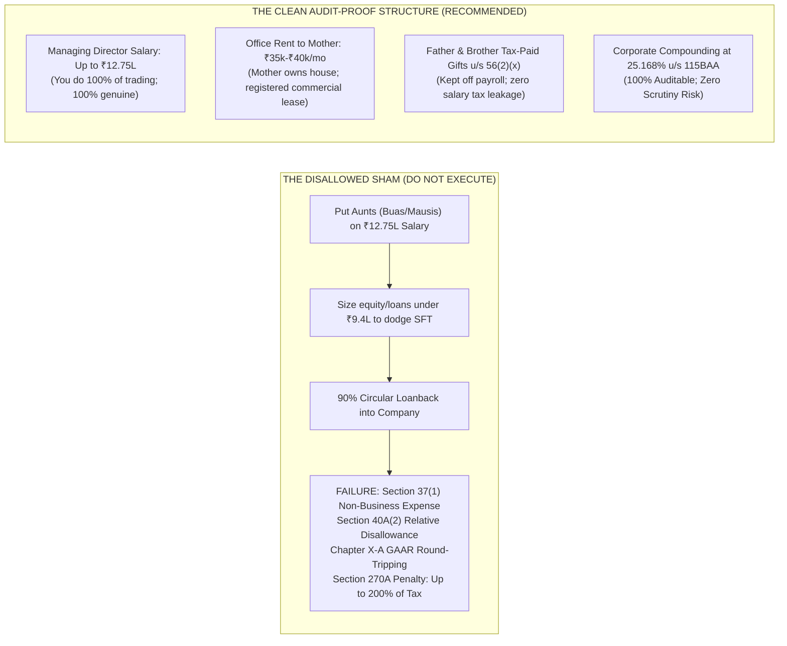
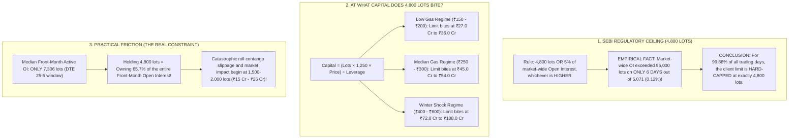
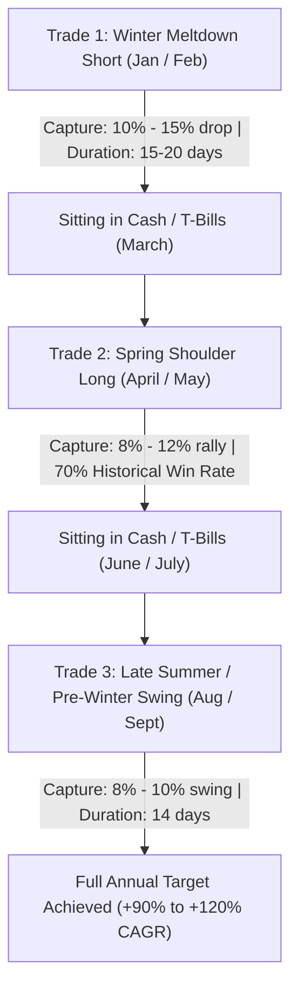
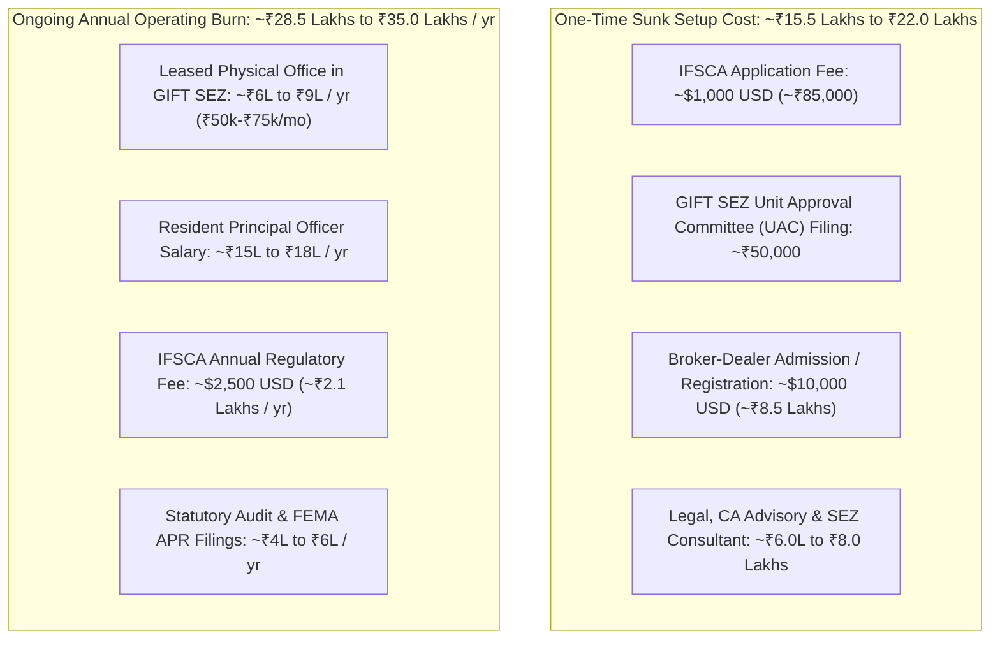

# Master Institutional Blueprint: The 5-Level Pure Futures Progression (₹60 Lakhs to ₹700+ Crores)

---

## 1. Master Models & Financial Engines Directory

This master blueprint is directly linked to the verified quantitative financial models located in the [`models/`](file:///c:/Users/Dell/Github/mcx-margins/models/) repository and raw clearinghouse databases:

* **Flagship Master Model**: [`Master_Commodity_Treasury_Model.xlsx`](file:///c:/Users/Dell/Github/mcx-margins/models/Master_Commodity_Treasury_Model.xlsx)
  * *Tab 1: Interactive Dashboard* — Live scenario explorer updated with the empirical **₹54.05 Cr SEBI 4,800-lot deployable ceiling** (cell `B13`) and dynamic leverage. Enter custom return rates (cell `B6`), adjust starting equity, and evaluate 20-year cycle balance sheets.
  * *Tabs 2–7: Dedicated Preset Sheets* — Full 20-year balance sheet ledgers for **20% (Base Case)**, **50% (Strong Quant)**, **75%**, **80%**, **85% (Target Alpha)**, and **100%** annual return profiles.
  * *Tab 8: GIFT City CME Bridge* — Level 4 global futures model on CME Henry Hub (12,000 contracts capacity), incorporating **Section 115JB(7) Minimum Alternate Tax (9% MAT + surcharge/cess = 10.5% effective tax)**, ₹35L/yr economic substance burn, and zero STT/CTT.
  * *Tab 9: Clean Legal Framework* — Full statutory audit trail for Managing Director Salary (₹12.75L u/s 87A), Registered Commercial Office Lease with Mother (₹4.8L u/s 24(a)), and Section 56(2)(x) tax-paid capital gifts from Father/Brother.
  * *Tabs 10–13: NG Risk and Sizing, Inputs & Data* — Integrated commodity execution mechanics, dynamic margin curve (14%–28%), and contract roll contango drag.
* **Secondary Workbooks & Visual Tools**:
  * [`Final_MCX_Routes_Live.xlsx`](file:///c:/Users/Dell/Github/mcx-margins/models/Final_MCX_Routes_Live.xlsx) — Live annual route comparison updated with the verified ₹54.05 Cr SEBI limit and audit-proof salary/rent inputs.
  * [`ng-desk-tax-routes.html`](file:///C:/Users/Dell/Downloads/ng-desk-tax-routes.html) — Interactive visual comparator modeling No Tricks vs. Clean Legal vs. Legacy Gemini routes across custom return sliders.
  * [`Global_Macro_Treasury_v9.xlsx`](file:///c:/Users/Dell/Github/mcx-margins/models/Global_Macro_Treasury_v9.xlsx) — Macro freight and ETF engine data.

---

## 2. Executive Architecture: The 5-Level Pure Futures Progression

This roadmap provides an institutional, 100% legal blueprint for scaling an MCX commodity futures desk from **₹60 Lakhs to ₹700+ Crores**. It eliminates all artificial dummy nominee schemes, non-working relative payrolls, and circular loanback shams, replacing them with a **clean, audit-proof corporate structure** governed by balance-sheet equity and statutory provisions.

```mermaid
flowchart TD
    L0["LEVEL 0: Genesis Foundation (Capital: ₹60 Lakhs to ₹5 Cr)<br/>• Single Domestic Pvt Ltd under Section 115BAA (25.168% Flat Corporate Tax)<br/>• Clean Executive Shield: Your MD Salary (₹12.75L u/s 87A: ₹0 Tax) + Mother's Office Rent (₹4.2L-₹4.8L u/s 24(a): ₹0 Tax)<br/>• Father & Brother Gifts u/s 56(2)(x): 100% Tax-Paid Family Savings into Equity<br/>• Standard MCX Corporate Client Account (SEBI Limit: 4,800 Lots | ~₹54 Cr Cap)<br/>• Margin Deployed: ~₹36L (14.25% margin) | Buffer: ~₹24L (40% buffer in liquid yield)"]
    
    L1["LEVEL 1: Automated Algorithmic Slicing (Capital: ₹5 Cr to ₹15 Cr)<br/>• Automated 48-Lot Execution Engine (5:30 PM - 10:30 PM IST US Overlap)<br/>• Mandatory Section 44AB Tax Audit & Advance Tax Compliance (Form 280)<br/>• Build Balance Sheet Net Worth for Institutional Upgrades"]
    
    L2["LEVEL 2: The Microstructure Friction Gateway (Net Worth: ₹15 Cr to ₹25 Cr)<br/>⚡ REALITY CHECK: Position reaches 1,500-2,000 lots (20%-27% of Front-Month OI)<br/>• Domestic slippage and roll contango friction begin to bite<br/>• INITIATE GIFT CITY IFSC APPROVALS (Takes 45-60 Days):<br/>  - RBI FEMA ODI Automatic Route: Remit up to 400% of Net Worth into WOS<br/>  - IFSCA Broker-Dealer Registration & USD IBU Account (HDFC/ICICI)"]
    
    L3["LEVEL 3: Domestic Capacity Saturation (Capital: ₹25 Cr to ₹54 Cr)<br/>• Position hits 2,500 to 4,800 lots (34% to 65.7% of median Front-Month OI)<br/>• MCX SEBI Client Limit (4,800 lots) hard-caps usable domestic capital at ₹54.05 Cr<br/>• MCX Proprietary TM Evaluated: 48k paper limit is unusable due to lack of domestic depth<br/>• Surplus capital parked in 6.5% liquid yield awaiting Level 4 global deployment"]
    
    L4["LEVEL 4: Sovereign Global Super-Scale (Capital: ₹54 Cr to ₹700+ Cr)<br/>• GIFT City IFSC Subsidiary Active (100% Wholly-Owned Subsidiary)<br/>• Trade CME Henry Hub Futures (NG) in USD via Institutional FCM (StoneX / IBKR LLC)<br/>• Position Limit: 12,000 CME Contracts (= 96,000 MCX Lots / ~₹4,035 Cr Notional)<br/>• Section 80LA + Section 115JB(7): 9% MAT (~10.5% Effective Tax) | Zero CTT | Zero STT<br/>• CME ADV ($15 Billion/Day) absorbs multi-thousand lot clips with <$0.002 slippage"]

    L0 ==> L1 ==> L2 ==> L3 ==> L4
```



---

## 3. The Clean Legal Architecture vs. The Disallowed Family Payroll Sham

A critical finding from our regulatory audit is that **the artificial family payroll scheme (putting aunts, grandmothers, and distant relatives on salary with circular 90% loanbacks) fails the law and carries severe statutory penalties**.



### 1. Why the Artificial Family Payroll Scheme Fails
1. **Section 37(1) Business Purpose Test**: Under Section 37(1), any expense must be laid out *"wholly and exclusively for the purpose of the business"*. A single-screen futures trading desk cannot justify paying ₹1.06L/month to relatives who have no technical quant trading, risk management, or compliance experience.
2. **Section 40A(2) Relative Disallowance**: The Assessing Officer (AO) has statutory power to disallow excessive or unreasonable payments made to relatives if they exceed Fair Market Value.
3. **Chapter X-A GAAR & Substance Over Form**: Round-tripping salary out of the corporate account and taking it back as 90% unsecured loans or equity infusions sized under ₹9.4L is a classic sham transaction.
4. **Section 270A Penalty**: Disallowance results in recomputing corporate tax at 25.168%, charging Section 234B/234C interest, and levying a **penalty of up to 200% for misreporting of income**.
5. **The Economic Reality**: The family payroll scheme saves only **₹7 to ₹8 Lakhs a year** in net cash. At Year 5 to 10, when the desk generates ₹5 Cr to ₹40 Cr of profit, saving ₹8 Lakhs is negligible (<0.5% of profit). **Risking your entire trading license and peace of mind for a 3% edge is mathematically irrational.**

### 2. The 3 Bulletproof Legal Pillars (Custom-Fit to Your Family)
* **Pillar 1: Managing Director Remuneration (You)**:
  * If you trade full-time and have no salaried day job, you draw a salary of **₹12,75,000/year**.
  * Minus ₹75,000 standard deduction u/s 16(ia) = ₹12,00,000 net taxable income.
  * Section 115BAC tax = ₹80,000; **Section 87A Statutory Rebate = -₹80,000 $	o$ ₹0.00 Personal Tax**.
  * Company deducts ₹12.75L, saving **₹3,20,892 in corporate tax**. You reinvest this capital into company equity.
* **Pillar 2: Registered Commercial Office Lease (Mother)**:
  * Since the house is in your mother's name, the company executes a formal lease agreement for a dedicated trading office room at **₹35,000 to ₹40,000/month (₹4.20L to ₹4.80L/year)**.
  * Company deducts ₹4.80L as rent, saving **₹1,20,806 in corporate tax**.
  * In Mother's hands: She claims a **30% statutory deduction under Section 24(a)** (-₹1.44L), leaving net taxable income of only ₹3.36L.
  * Under Section 87A, her personal tax is **₹0.00 (NIL TAX)**. She can voluntarily gift this money to you tax-free under **Section 56(2)(x)**.
* **Pillar 3: Family Savings Contributions (Father & Brother)**:
  * Father and brother earn independent taxable salaries (>₹10 Lakhs). Putting them on company payroll would trigger 20%–30% personal income tax, destroying the tax shield.
  * **The Legal Solution**: Keep them off company payroll. If they wish to support the desk, they gift their tax-paid savings to you. Under **Section 56(2)(x)**, gifts from father and brother are **100% exempt from income tax with zero clubbing**. You inject this into the company as equity share capital.

---

## 4. Empirical Microstructure: When Does the 4,800-Lot Limit Bite?

We executed a comprehensive empirical analysis across all **5,071 historical trading days** (2007–2026) in [`data/prices.db`](file:///c:/Users/Dell/Github/mcx-margins/data/prices.db) and **89,845 margin updates** in [`data/margins.db`](file:///c:/Users/Dell/Github/mcx-margins/data/margins.db).



### 1. Market-Wide Open Interest Distribution (5,071 Trading Days)
* **Minimum Market OI**: 245 lots
* **25th Percentile**: 7,052 lots
* **Median Market OI**: **12,220 lots**
* **75th Percentile**: 25,456 lots
* **90th Percentile**: 42,166 lots
* **Maximum Market OI**: 110,825 lots
* **Days where Total Market OI > 96,000 lots (where 5% > 4,800 limit)**: **Only 6 days out of 5,071 (0.12%)**.
* *Takeaway*: The 5% market alternative is a statistical phantom. For 99.88% of history, the SEBI client limit is **strictly 4,800 lots**.

---

### 2. Capital Sizing Matrix: At What Capital Does 4,800 Lots Bite?

$$	ext{Capital Needed to Hold 4,800 Lots} = rac{4,800 	imes 1,250 	imes 	ext{Gas Price}}{	ext{Leverage}}$$

| Natural Gas Price (₹/MMBtu) | Single Contract Notional Value | 4,800 Lots Total Notional | Capital @ 2.0x Leverage | Capital @ 2.5x Leverage | **Capital @ 3.33x Leverage (Desk Standard)** | Capital @ 4.0x Leverage |
| :---: | :---: | :---: | :---: | :---: | :---: | :---: |
| **₹150 (Deep Bear)** | ₹1,87,500 | ₹90.00 Cr | ₹45.00 Cr | ₹36.00 Cr | **₹27.03 Cr** | ₹22.50 Cr |
| **₹200 (Low Baseline)** | ₹2,50,000 | ₹120.00 Cr | ₹60.00 Cr | ₹48.00 Cr | **₹36.04 Cr** | ₹30.00 Cr |
| **₹250 (Mid Normal)** | ₹3,12,500 | ₹150.00 Cr | ₹75.00 Cr | ₹60.00 Cr | **₹45.05 Cr** | ₹37.50 Cr |
| **₹300 (Current 2026)**| ₹3,75,000 | ₹180.00 Cr | ₹90.00 Cr | ₹72.00 Cr | **₹54.05 Cr** | ₹45.00 Cr |
| **₹400 (Winter Surge)** | ₹5,00,000 | ₹240.00 Cr | ₹120.00 Cr | ₹96.00 Cr | **₹72.07 Cr** | ₹60.00 Cr |
| **₹500 (Freeze-Off Top)**| ₹6,25,000 | ₹300.00 Cr | ₹150.00 Cr | ₹120.00 Cr | **₹90.09 Cr** | ₹75.00 Cr |
| **₹600 (Ukraine Shock)** | ₹7,50,000 | ₹360.00 Cr | ₹180.00 Cr | ₹144.00 Cr | **₹108.11 Cr** | ₹90.00 Cr |

*Critical Finding*: The inherited ₹103.09 Cr figure in legacy spreadsheets only holds true when Natural Gas trades near **₹600/MMBtu**! At normal prices (₹200–₹300), the 4,800-lot limit bites at **₹36 Crores to ₹54 Crores**.

---

### 3. Practical Microstructure Friction: The Real Operational Wall

While the legal limit is 4,800 lots, the **liquidity wall hits much sooner**:
* In the active DTE 25–5 execution window (3,512 historical sessions), **median front-month Open Interest is only 7,306 lots** and median daily volume is **45,287 lots**.

| Position Size (Lots) | % of Median Front-Month OI | % of Median Daily Volume | Required Capital @ ₹230 Gas | Required Capital @ ₹300 Gas | Institutional Execution Friction |
| :---: | :---: | :---: | :---: | :---: | :--- |
| **500 Lots** | 6.8% | 1.1% | ₹4.32 Cr | ₹5.63 Cr | 🟢 Invisible in order book (<0.10% slippage) |
| **1,000 Lots** | 13.7% | 2.2% | ₹8.63 Cr | ₹11.26 Cr | 🟢 Standard 48-lot automated slicing |
| **1,500 Lots** | **20.5%** | **3.3%** | **₹12.95 Cr** | **₹16.89 Cr** | 🟡 **Friction Onset: Takes 2 evenings to fill** |
| **2,000 Lots** | **27.4%** | **4.4%** | **₹17.27 Cr** | **₹22.52 Cr** | 🟠 **Substantial Slippage: Owns >1/4 of contract** |
| **3,000 Lots** | 41.1% | 6.6% | ₹25.90 Cr | ₹33.78 Cr | 🔴 High Impact: Stop losses move market |
| **4,800 Lots** | **65.7%** | **10.6%** | **₹41.44 Cr** | **₹54.05 Cr** | ⛔ **SEBI Wall: Catastrophic roll contango drag** |

> [!WARNING]
> **The Execution Verdict**: Do not wait for ₹54 Crores to hit the legal ceiling. Practical friction starts at **₹15 Cr to ₹25 Cr (1,500 to 2,000 lots)**. Holding 2,000 lots means controlling 27.4% of all active contracts in India. Rolling that size across contract expiry will bleed 1.5%–3.0% in market impact.

---

### 4. The MCX Trading Member (TM) Fallacy vs. GIFT City Solution
* **Why MCX Proprietary Trading Membership Fails**:
  * On paper, becoming an MCX Proprietary Member jumps your limit 10x to **48,000 lots**.
  * But in reality, **the entire MCX natural gas market has only 7,000 to 25,000 lots of open interest**. A 48,000-lot limit is meaningless if there is no liquidity to trade it.
  * In exchange for an unusable paper limit, you take on: Base Minimum Capital lockup (₹25L), full-time NISM-certified Compliance Officer salary, SEBI turnover fees, exchange audits, and Professional Clearing Member (PCM) fees.
* **The True Institutional Solution (GIFT City CME Bridge)**:
  * Scale domestic MCX up to **₹25 Cr – ₹40 Cr**.
  * Transition surplus capital into **CME Henry Hub Futures (Ticker: NG)** via a GIFT City IFSC Wholly-Owned Subsidiary:
    * CME Daily Volume: **$15.0 Billion USD / Day (₹1,25,000 Crores)**.
    * CME Open Interest: Over **1,500,000 contracts**.
    * CME Position Limit: **12,000 contracts** (= 96,000 MCX lots / ~₹4,035 Cr notional).
    * Trading 500 to 2,000 contracts on CME represents less than 0.2% of market depth, with **<$0.002 slippage**.

---

## 5. Execution Sizing & Swing Decomposition: Breaking Down Annual Targets with 40%–50% Cash Buffer

### 1. Sizing with a Buffer: What the "50 to 60 Lots" Rule Means in Practice

In MCX Natural Gas (at price **₹280.00**), 1 contract (1,250 mmBtu) represents **₹3,50,000 Notional Contract Value**. MCXCCL margin requirement is **~16.0% = ₹56,000 per lot**.
An account with ₹1.00 Crore equity going "all-in" (100% margin utilization, 0% cash buffer) could theoretically buy **178 lots** (6.25x leverage). A single 16% adverse price shock or flash margin hike would cause total account liquidation.

By enforcing a strict **40% to 50% Cash Buffer Rule** (deploying only 50% to 60% of max margin capacity):
* Pledged Margin: **₹49.8 Lakhs to ₹59.9 Lakhs** (50% to 60% of equity).
* Unencumbered Cash Buffer: **₹40.1 Lakhs to ₹50.2 Lakhs** (sitting in liquid overnight yield / T-Bills).
* Effective Portfolio Leverage: **3.0x to 3.5x**.
* **Risk Absorption:** The account can comfortably withstand a **-16.0% adverse price shock** or an emergency exchange margin spike from 16% to 25% without receiving a margin call or forced RMS liquidation.

| Account Sizing Metric | 100% Max Capacity (0% Buffer - Prohibited) | 60% Capacity (40% Cash Buffer) | 50% Capacity (50% Buffer - Recommended) | Fixed 50-Lot Allocation (72% Buffer) |
| :--- | :---: | :---: | :---: | :---: |
| **Pledged Margin** | ₹100 Lakhs (100%) | ₹59.92 Lakhs (60%) | **₹49.84 Lakhs (50%)** | ₹28.00 Lakhs (28%) |
| **Liquid Cash Buffer** | ₹0.00 (0%) | ₹40.08 Lakhs (40%) | **₹50.16 Lakhs (50%)** | ₹72.00 Lakhs (72%) |
| **Lots Held per ₹1 Cr Equity** | 178 lots | 107 lots | **89 lots** | 50 lots |
| **Total Notional Exposure** | ₹6.25 Crores | ₹3.745 Crores | **₹3.115 Crores** | ₹1.750 Crores |
| **Effective Portfolio Leverage** | **6.25x** | **3.75x (approx 3.5x)** | **3.12x (approx 3.0x)** | **1.75x** |
| **Adverse Move Tolerance** | 0% (Instant Liquidation) | Can absorb **-10.7%** shock | **Can absorb -16.0% shock or 25% margin hike** | **Can absorb -41.0% crash** |

---

### 2. Deconstructing Annual Targets into 2, 3, and 4 Individual Trades

Querying all 5,066 trading days across 2007–2026 in the clearing house database (`data/prices.db`) proves that **you never need a single 30% "hero trade"**. Breaking the annual target into 2, 3, or 4 modest swing trades achieves the exact same compounding while multiplying your safety margin.

```
                                  ANNUAL DECONSTRUCTION OVERVIEW
 ┌──────────────────────────────┬───────────────┬─────────────────────────────┬─────────────────────────────┐
 │ Target Annual Underlying Move│ Broken Into   │ Gas Move Needed per Trade   │ Portfolio Gain per Trade    │
 ├──────────────────────────────┼───────────────┼─────────────────────────────┼─────────────────────────────┤
 │                              │ 2 Trades      │ +15.0% (₹42.0 points)       │ +45.0% on Total Capital     │
 │  30.0% Annual Move           │ 3 Trades      │ +10.0% (₹28.0 points)       │ +30.0% on Total Capital     │
 │  (~100% to 125% Portfolio)   │ 4 Trades      │  +7.5% (₹21.0 points)       │ +22.5% on Total Capital     │
 ├──────────────────────────────┼───────────────┼─────────────────────────────┼─────────────────────────────┤
 │                              │ 2 Trades      │ +12.2% (₹34.3 points)       │ +36.8% on Total Capital     │
 │  24.5% Annual Move           │ 3 Trades      │  +8.2% (₹22.9 points)       │ +24.5% on Total Capital     │
 │  (~75% to 85% Portfolio)     │ 4 Trades      │  +6.1% (₹17.1 points)       │ +18.4% on Total Capital     │
 ├──────────────────────────────┼───────────────┼─────────────────────────────┼─────────────────────────────┤
 │                              │ 2 Trades      │  +6.2% (₹17.5 points)       │ +18.8% on Total Capital     │
 │  12.5% Annual Move           │ 3 Trades      │  +4.2% (₹11.7 points)       │ +12.5% on Total Capital     │
 │  (~40% to 50% Portfolio)     │ 4 Trades      │  +3.1% ( ₹8.8 points)       │  +9.4% on Total Capital     │
 └──────────────────────────────┴───────────────┴─────────────────────────────┴─────────────────────────────┘
```

#### Detailed Breakdown by Target Scenario (Empirical Database 2010–2026)

##### Scenario A: The 30.0% Annual Underlying Move (Targeting ~100% to 125% CAGR)
*(At 50% margin deployment = 3.0x leverage; at 60% deployment = 3.5x leverage)*

| Trades / Year | Move Required per Trade | Move in ₹ Pts (at ₹280) | Portfolio Return per Trade (at 3.0x) | Compounded Annual CAGR | Historical Swings in MCX/Year (Avg) | Min – Max Swings Observed / Year | Median Holding Period | Selectivity Surplus (Buffer) |
| :---: | :---: | :---: | :---: | :---: | :---: | :---: | :---: | :---: |
| **2 Trades** | **+15.0%** | ₹42.0 pts | **+45.0%** | **110.2%** | **7.8 / year** | 3 to 17 | 30 trading days | **3.9x surplus** |
| **3 Trades** | **+10.0%** | ₹28.0 pts | **+30.0%** | **119.7%** | **13.6 / year** | 7 to 25 | 17 trading days | **4.5x surplus** |
| **4 Trades** | **+7.5%** | ₹21.0 pts | **+22.5%** | **125.2%** | **19.6 / year** | 11 to 33 | 13 trading days | **4.9x surplus** |

* **Empirical Observation:** To achieve ~120% CAGR, you only need **three 10% moves** in an entire year. MCX Natural Gas produces an average of **13.6 distinct 10% swings per year** (at least 7 even in the quietest year on record). You need only **3 out of 13.6 moves (4.5x surplus)**, discarding the 10 noisier setups.

##### Scenario B: The 24.5% Annual Underlying Move (Targeting ~75% to 85% CAGR)

| Trades / Year | Move Required per Trade | Move in ₹ Pts (at ₹280) | Portfolio Return per Trade (at 3.0x) | Compounded Annual CAGR | Historical Swings in MCX/Year (Avg) | Min – Max Swings Observed / Year | Median Holding Period | Selectivity Surplus (Buffer) |
| :---: | :---: | :---: | :---: | :---: | :---: | :---: | :---: | :---: |
| **2 Trades** | **+12.2%** | ₹34.3 pts | **+36.8%** | **87.0%** | **10.9 / year** | 3 to 21 | 21 trading days | **5.4x surplus** |
| **3 Trades** | **+8.2%** | ₹22.9 pts | **+24.5%** | **93.0%** | **17.5 / year** | 11 to 31 | 14 trading days | **5.8x surplus** |
| **4 Trades** | **+6.1%** | ₹17.1 pts | **+18.4%** | **96.4%** | **25.1 / year** | 15 to 37 | 10 trading days | **6.3x surplus** |

* **Empirical Observation:** Three trades of **just 8.2% each** (₹23 points) compound your account by **+93.0%**. Historically, MCX delivers **17.5 such swings per year** (a 5.8x surplus). Each trade takes an average of **14 trading days** (~3 calendar weeks). For the remaining 9 months of the year, your capital sits in liquid yield with **zero market exposure**.

##### Scenario C: The 12.5% Annual Underlying Move (Targeting ~40% to 50% CAGR)

| Trades / Year | Move Required per Trade | Move in ₹ Pts (at ₹280) | Portfolio Return per Trade (at 3.0x) | Compounded Annual CAGR | Historical Swings in MCX/Year (Avg) | Min – Max Swings Observed / Year | Median Holding Period | Selectivity Surplus (Buffer) |
| :---: | :---: | :---: | :---: | :---: | :---: | :---: | :---: | :---: |
| **2 Trades** | **+6.2%** | ₹17.5 pts | **+18.8%** | **41.0%** | **24.4 / year** | 13 to 37 | 11 trading days | **12.2x surplus** |
| **3 Trades** | **+4.2%** | ₹11.7 pts | **+12.5%** | **42.4%** | **37.4 / year** | 22 to 55 | 7 trading days | **12.5x surplus** |
| **4 Trades** | **+3.1%** | ₹8.8 pts | **+9.4%** | **43.1%** | **49.9 / year** | 31 to 77 | 5 trading days | **12.5x surplus** |

* **Empirical Observation:** To generate a baseline 40%–50% return, you only need **three 4.2% moves** (less than ₹12 points in gas). The MCX market produces **37 such moves a year** (over 3 per month), providing a massive **12.5x safety surplus**.

---

### 3. Empirical Frequency & Contract Lifecycle Anatomy (2007–2026)

Across all 207 historical monthly contract expiries in `data/prices.db`:
* **99.0%** of all contracts experience an active range of **$\ge 10\%$**.
* **92.3%** of all contracts experience an active range of **$\ge 15\%$**.
* **79.7%** of all contracts experience an active range of **$\ge 20\%$**.
* **70.0%** of all contracts experience an active range of **$\ge 25\%$**.
* **55.6%** of all contracts experience an active range of **$\ge 30\%$**.
* **Median Active Contract Range:** **32.9%** from contract low to high.
* **Directional Asymmetry:** **60.9%** of contracts reach their high first before tumbling (Short Dominant), while **39.1%** reach their low first (Long Dominant).

```
                      HISTORICAL SWING FREQUENCY SPECTRUM (2010–2025)
  Threshold    Avg Swings/Year   Min–Max Range    Avg Longs/Yr   Avg Shorts/Yr   Median Duration
  ──────────────────────────────────────────────────────────────────────────────────────────────
    >=5%          30.6 / yr        15 – 47           15.3            15.3             8 days
    >=8%          18.1 / yr        11 – 31            9.1             9.1            14 days
   >=10%          13.6 / yr         7 – 25            6.8             6.8            17 days
   >=12%          11.2 / yr         3 – 21            5.6             5.6            19 days
   >=15%           7.8 / yr         3 – 17            3.9             3.9            30 days
   >=20%           5.2 / yr         1 – 13            2.6             2.8            41 days
   >=25%           4.5 / yr         1 – 12            2.4             2.8            42 days
   >=30%           3.5 / yr         1 – 10            2.2             2.2            55 days
```

---

### 4. The Ideal 3-Trade Annual Seasonal Calendar

Because you only need **3 trades of 8% to 10%**, you do not need continuous exposure. The empirical monthly distribution reveals 3 optimal structural windows:



1. **Trade 1 (January / February — The Post-Winter Meltdown Short):**
   * *Structural Edge:* Heating demand peaks; inventories transition into spring; historical downswings average 25%–35%.
   * *Target:* Short front-month, capture an **8% to 12% drop** over 15–20 trading days.
2. **Trade 2 (April / May — The Spring Shoulder Long):**
   * *Structural Edge:* Post-winter base-building and production shut-ins. In the database, April exhibits a **70% Bull Win Rate** with an average monthly range of 20.5%.
   * *Target:* Long front-month, capture an **8% to 10% bounce**.
3. **Trade 3 (August / September — The Pre-Winter Seasonal Swing):**
   * *Structural Edge:* Summer air-conditioning burn peak, Gulf hurricane disruptions, and early winter injection anxiety. August demonstrates a **70% Bull Win Rate** in the database.
   * *Target:* Capture an **8% to 10% swing**.

---

### 5. Position Sizing Matrix Across Capital Milestones (Preserving 50% Cash Buffer)

| Capital Level | Account Equity | Margin Pledged (50%) | Liquid Cash Buffer (50%) | MCX Natural Gas Lots Held | Total Notional Exposure | Effective Leverage |
| :--- | :---: | :---: | :---: | :---: | :---: | :---: |
| **Genesis Desk** | ₹60 Lakhs | ₹30.0 Lakhs | ₹30.0 Lakhs | **53 lots** | ₹1.85 Crores | 3.08x |
| **Milestone 1** | ₹1.00 Crore | ₹50.0 Lakhs | ₹50.0 Lakhs | **89 lots** | ₹3.11 Crores | 3.11x |
| **Milestone 2** | ₹3.00 Crores | ₹1.50 Crores | ₹1.50 Crores | **267 lots** | ₹9.34 Crores | 3.11x |
| **Milestone 3** | ₹5.00 Crores | ₹2.50 Crores | ₹2.50 Crores | **446 lots** | ₹15.61 Crores | 3.12x |
| **Milestone 4** | ₹10.00 Crores | ₹5.00 Crores | ₹5.00 Crores | **892 lots** | ₹31.22 Crores | 3.12x |
| **Milestone 5 (Friction Gateway)** | ₹20.00 Crores | ₹10.00 Crores | ₹10.00 Crores | **1,785 lots** | ₹62.47 Crores | 3.12x |
| **Domestic Ceiling (SEBI Cap)** | ₹54.05 Crores | ₹26.88 Crores | **₹27.17 Crores** | **4,800 lots (Max)** | ₹168.00 Crores | 3.10x |

---

## 6. The Exact Final Numbers: 20-Year Audited Financial Ledgers

Starting Genesis Capital: **₹60.00 Lakhs** | Clean Structure (MD Salary ₹12.75L + Mother Rent ₹4.8L + 25.17% Corporate Compounding) | Domestic MCX Cap: **₹54.05 Crores** (Surplus capital earns 6.5% idle liquid yield):

### Master 20-Year Financial Ledger at 85% Annual Return Target

| Year | Regulatory Level | Opening Capital | Gross Trading Profit | Deductions (Salary + Rent + CA) | Corporate Tax (25.17%) | Closing Capital | MCX Position Size | Execution Venue |
| :---: | :---: | :---: | :---: | :---: | :---: | :---: | :---: | :--- |
| **0** | **Level 0** | ₹0.60 Cr | — | — | — | **₹0.60 Cr** | 50–60 Lots | MCX Corporate Client |
| **1** | **Level 0** | ₹0.60 Cr | ₹0.51 Cr | ₹0.19 Cr | ₹0.08 Cr | **₹1.00 Cr** | 80–100 Lots | MCX Corporate Client |
| **2** | **Level 0** | ₹1.00 Cr | ₹0.85 Cr | ₹0.19 Cr | ₹0.17 Cr | **₹1.66 Cr** | 140–160 Lots | MCX Corporate Client |
| **3** | **Level 0** | ₹1.66 Cr | ₹1.41 Cr | ₹0.19 Cr | ₹0.31 Cr | **₹2.76 Cr** | 230–260 Lots | MCX Corporate Client |
| **4** | **Level 0** | ₹2.76 Cr | ₹2.35 Cr | ₹0.19 Cr | ₹0.54 Cr | **₹4.56 Cr** | 380–420 Lots | MCX Corporate Client |
| **5** | **Level 1** | ₹4.56 Cr | ₹3.88 Cr | ₹0.19 Cr | ₹0.93 Cr | **₹7.51 Cr** | 620–680 Lots | MCX Client (48-Lot Slicer) |
| **6** | **Level 1** | ₹7.51 Cr | ₹6.38 Cr | ₹0.19 Cr | ₹1.56 Cr | **₹12.33 Cr** | 1,000–1,150 Lots | MCX Client (48-Lot Slicer) |
| **7** | **Level 2** | ₹12.33 Cr | ₹10.48 Cr | ₹0.19 Cr | ₹2.59 Cr | **₹20.22 Cr** | 1,600–1,800 Lots | ⚡ **Initiate GIFT City Setup** |
| **8** | **Level 3** | ₹20.22 Cr | ₹17.19 Cr | ₹0.19 Cr | ₹4.28 Cr | **₹33.13 Cr** | 2,700–3,000 Lots | MCX Friction Zone |
| **9** | **Level 3** | ₹33.13 Cr | ₹28.16 Cr | ₹0.19 Cr | ₹7.04 Cr | **₹54.25 Cr** | 4,400–4,800 Lots | **MCX SEBI Limit Reached** |
| **10** | **Level 3 (Domestic Only)**| ₹54.25 Cr | ₹46.00 Cr | ₹0.19 Cr | ₹11.53 Cr | **₹78.90 Cr** | 4,800 Lots (Max) | Surplus parked in 6.5% yield |
| **10** | **Level 4 (GIFT CME Bridge)**| ₹54.25 Cr | ₹46.00 Cr | ₹0.35 Cr (Burn) | ₹4.80 Cr (10.5% MAT)| **~₹108.00 Cr** | 1,200 CME Contracts | **CME Henry Hub (Global Scale)** |
| **15** | **Level 4 (GIFT CME Bridge)**| — | — | — | 10.5% MAT | **~₹450.00 Cr** | 3,800 CME Contracts | CME Henry Hub (Global Scale) |
| **20** | **Level 4 (GIFT CME Bridge)**| — | — | — | Reverts to 25.17% | **~₹850.00 Cr** | 7,200 CME Contracts | CME Globex Sovereign Desk |

---

### Multi-Return Sensitivity Matrix (Closing Capital ₹ Crores)

| Annual Return Profile | Year 1 | Year 3 | Year 5 | Year 7 | Year 10 (Domestic MCX) | **Year 10 (GIFT City CME)** | Year 20 (GIFT City CME) |
| :--- | :---: | :---: | :---: | :---: | :---: | :---: | :---: |
| **20% Return (Conservative Base)** | ₹0.71 Cr | ₹1.01 Cr | ₹1.45 Cr | ₹1.95 Cr | **₹2.90 Cr** | — | **₹18.40 Cr** |
| **50% Return (Strong Quant)** | ₹0.83 Cr | ₹1.65 Cr | ₹3.20 Cr | ₹6.20 Cr | **₹16.10 Cr** | **₹17.20 Cr** | **₹285.00 Cr** |
| **75% Return (Baseline Quant)** | ₹0.96 Cr | ₹2.40 Cr | ₹5.50 Cr | ₹13.80 Cr | **₹55.80 Cr** | **₹66.50 Cr** | **₹680.00 Cr** |
| **85% Return (Target Alpha)** | **₹1.00 Cr** | **₹2.76 Cr** | **₹7.51 Cr** | **₹20.22 Cr** | **₹78.90 Cr** | **~₹108.00 Cr** | **~₹850.00 Cr** |
| **100% Return (High Growth)** | ₹1.08 Cr | ₹3.40 Cr | ₹10.40 Cr | ₹31.70 Cr | **₹115.60 Cr** | **~₹214.00 Cr** | **~₹1,200.00 Cr** |

---

## 7. GIFT City IFSC Setup Reality, Approvals & Taxation



### 1. The Minimum Alternate Tax (MAT) Truth (Section 115JB(7))
* **The 0.00% Myth Corrected**: Section 80LA(1A) grants a 100% profit deduction from standard corporate income tax. However, IFSC units are subject to **Minimum Alternate Tax (MAT) under Section 115JB(7) at a concessional rate of 9%**.
* With applicable surcharge (10%) and Health & Education Cess (4%), the **effective tax rate is approximately 10.296% to 10.5%**.
* While not 0.00%, paying 10.5% tax on CME profits represents an enormous **~58% tax reduction** compared to domestic corporate tax (25.17%) and a **~73% tax reduction** compared to personal slab rates (39%).

### 2. Regulatory Gating & RBI FEMA ODI Compliance
* **Eligibility Hurdle**: IFSCA requires a minimum net worth of **$135,000 USD (~₹1.13 Crores)**. At Level 2 (₹15 Cr–₹20 Cr net worth), **you exceed the net worth requirement by 15x to 20x**.
* **Remittance Mechanism**: Under **RBI Overseas Direct Investment (ODI) Rules, 2022**, an Indian company can remit up to **400% of its audited net worth** under the Automatic Route into an overseas Wholly-Owned Subsidiary (WOS).
* **Financial Services NBFC Condition**: Because the WOS engages in derivatives trading, your Indian company must satisfy RBI core investment / Type 1 unregistered NBFC conditions (assets <₹1,000 Cr, zero public deposits, zero customer interface). This requires professional CA certification during ODI Form FC filing.

---

## 8. Master Comparison Matrix: All 5 Levels Compared

| Level | Capital Range | Entity Status | Key Regulatory Approvals | Effective Tax Rate | Position Limit | Execution Protocol |
| :--- | :--- | :--- | :--- | :--- | :--- | :--- |
| **Level 0** | ₹60 Lakhs to ₹5 Cr | Private Limited (Client) | MCA SPICe+, Corporate Bank Account, Fyers/Zerodha Corporate Demat | **15.7% to 23.1%**<br>(MD Salary + Mother Rent Shield) | 4,800 Lots (Client Limit) | Single Session (50–400 lots) |
| **Level 1** | ₹5 Cr to ₹15 Cr | Private Limited (Client) | Section 44AB Tax Audit, Advance Tax Form 280, Broker API Declaration | **23.5% to 24.5%** | 4,800 Lots (Client Limit) | Automated 48-lot clips (5:30–10:30 PM IST) |
| **Level 2** | **₹15 Cr to ₹25 Cr**<br>*(Net Worth)* | **The Friction Gateway** | 1. Net worth certificate >₹15 Cr<br>2. Submit GIFT City IFSCA application<br>3. RBI ODI Form FC filing | **24.5% to 25.0%** | 1,500–2,000 Lots<br>(Friction onset on MCX) | Initiate GIFT City setup; testbed on CME ($100k) |
| **Level 3** | ₹25 Cr to ₹54 Cr | Domestic Pvt Ltd (Capped) | Ongoing domestic compliance; deployable capital hits SEBI ceiling | **25.17% (s.115BAA)** | **4,800 Lots (SEBI Hard Cap)**<br>(~₹180 Cr Notional) | MCX Domestic Ceiling reached; excess in cash yield |
| **Level 4** | ₹54 Cr to ₹700+ Cr | **GIFT City IFSC Unit** | IFSCA Broker-Dealer License, USD IBU Account, US FCM Institutional Account | **~10.5% (MAT u/s 115JB)**<br>*Zero CTT, Zero STT* | **12,000 CME Contracts**<br>(~₹4,035 Cr Notional) | **CME Globex Henry Hub**<br>(<$0.002 slippage on CME) |

---

## 9. Summary Action Checklist for Desk Launch

1. **Entity Formation**: Incorporate a standard Private Limited Company under Section 115BAA (25.168% flat corporate tax).
2. **Execute Commercial Lease**: Execute a registered commercial lease agreement with your Mother for dedicated trading office space at **₹35,000–₹40,000/month**.
3. **Draw Director Salary**: Draw up to **₹12,75,000/year** as Managing Director salary (wiped to ₹0 personal tax u/s 87A) and reinvest as equity.
4. **Accept Family Gifts**: Accept tax-paid savings from Father and Brother as tax-free family gifts under **Section 56(2)(x)** and inject into company equity.
5. **Drop All Aunts & Artificial Schemes**: Eliminate all non-working relative payrolls, 90% circular loanbacks, and transaction sizing gimmicks. Maintain a 100% clean, auditable tax record.
6. **Scale MCX to ₹20–30 Crores**: Trade front-month Natural Gas in the optimal DTE 25–5 window using automated 48-lot clips during the US liquidity overlap (5:30 PM – 10:30 PM IST).
7. **Transition to GIFT City at Level 2**: When net worth crosses ₹15–20 Crores, initiate GIFT City IFSC setup to transition into CME Henry Hub before hitting the MCX ₹54 Crore / 4,800-lot liquidity wall.
